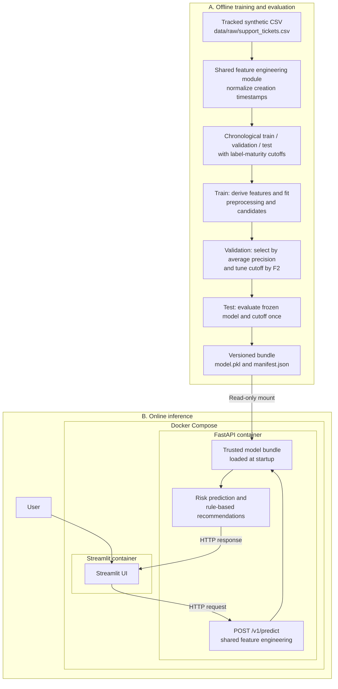

# Intelligent Ticket Triage & SLA Risk Prediction

> An end-to-end machine learning application for predicting SLA breach risk in operational support tickets using text, workload, team, and ticket characteristics.


---

## Overview

Support teams often discover high-risk tickets only after delays have already occurred.

This project predicts whether a newly created operational ticket is likely to breach its SLA and converts the model output into practical triage recommendations.

The application provides:

- SLA breach risk score
- Business-facing risk level
- Suggested ticket priority
- Operational recommendations
- Tuned decision threshold
- Versioned FastAPI inference service and interactive Streamlit interface
- Dockerized deployment

**All training and evaluation data is synthetic. These results have not been validated on real tickets.**

## Quick Demo

On Linux, use Bash with Git, Python 3.12 and its `venv` module, Docker with Compose v2, and curl. Run these commands in the same shell. Training uses the tracked CSV and generates a new bundle for this demo.

```bash
git clone https://github.com/Vai-bhv/intelligent-ticket-triage.git
cd intelligent-ticket-triage
python3.12 -m venv .venv
source .venv/bin/activate
python -m pip install -r requirements.txt

demo_runs="$(mktemp -d "$PWD/models/demo.XXXXXX")"
python src/train.py --output-dir "$demo_runs" &&
  export SLA_MODEL_BUNDLE="$(find "$demo_runs" -mindepth 1 -maxdepth 1 -type d -print -quit)" &&
  docker compose up --build --wait
```

Open [Streamlit](http://127.0.0.1:8501) and use **Predict SLA Risk** with the example ticket, or explore the [API docs](http://127.0.0.1:8000/docs).

```bash
curl -fsS http://127.0.0.1:8000/health/live
curl -fsS http://127.0.0.1:8000/health/ready
curl -fsS http://127.0.0.1:8501/_stcore/health
```

When finished, run `docker compose down` in the same shell. The generated bundle stays in the ignored `models/` directory. See [Docker](#docker) for mount details and [Inference API](#inference-api) for an example request.

---

## Business Problem

A standard ticket queue treats cases mainly according to manually assigned priority.

However, SLA risk also depends on factors such as:

- Ticket description
- Support category
- Current team backlog
- Team experience
- Previous reassignments
- Weekend creation
- SLA target
- Region and support channel

The goal is to identify likely SLA breaches early enough for teams to intervene.

---

## Architecture



---

## Dataset

The synthetic dataset contains 12,000 enterprise-style support tickets covering the period from 2023 to 2025.

Example ticket categories:

- Access Management
- Application Support
- Data Quality
- Infrastructure
- Workforce Operations

Main features include:

- Region
- Category
- Priority
- Assigned team
- Channel
- Ticket description
- Description length
- Backlog at creation
- Team experience
- Previous reassignments
- Weekend indicator
- SLA target hours
- Resolution hours
- SLA breach outcome

The generated SLA breach rate is approximately 12%.

---

## Feature Engineering

Training and Streamlit use the same feature code in `src/features.py`. The creation timestamp is normalized to UTC. Naive CSV timestamps are interpreted as UTC, and the form collects a UTC date and hour. Weekday, weekend, month, quarter, hour, and month-end are derived from that timestamp. A backlog of zero maps to the Low bucket.

### Text features

Ticket descriptions are transformed using TF-IDF with:

- Unigrams and bigrams
- English stop-word removal
- Sublinear term frequency
- Maximum vocabulary size of 3,000 features

### Numerical features

- Description length
- Backlog at creation
- Team experience
- Previous reassignments
- Weekend creation
- SLA target hours
- Day of week
- Month
- Quarter
- Creation hour
- Month-end indicator

### Categorical features

- Region
- Category
- Priority
- Assigned team
- Channel
- Backlog bucket

---

## Models

Training compares two classification pipelines:

| Model | Purpose |
|---|---|
| Logistic Regression | Interpretable baseline |
| XGBoost Classifier | Nonlinear candidate |

Training targets a chronological 60% train, 20% validation, and 20% test split.
Tickets with the same creation timestamp stay together in the later partition, so actual row counts can vary.

Label availability follows the simulator's rule that resolution after the SLA deadline counts as a breach. A non-breach becomes observable on resolution, including resolution exactly at the deadline. An unresolved ticket's breach becomes observable at its SLA deadline. The CSV stores rounded resolution hours and the generator computes the label before rounding. Training uses the recorded label to disambiguate a rounded tie.

Training and validation use labels observable by the first creation timestamp of the next partition, inclusive. Test uses labels observable by the evaluation cutoff. The default synthetic cutoff is the latest SLA deadline among test tickets, which assumes continuous observation through that time. Use `--evaluation-cutoff <timestamp>` to simulate an earlier observation cutoff. The manifest records the cutoff and excluded row count for each partition.

- **Train** fits both candidates and their preprocessing.
- **Validation** selects the candidate with the highest average precision. It selects the threshold that maximizes F2 over 0.10–0.90 in 0.01 increments among cutoffs with precision of at least 0.30. If none qualify, it chooses the best F2 across the grid and records that the floor was missed.
- **Test** scores the frozen winner once at the validation-selected threshold. The model is served as fitted on the training partition.

## Model Performance

These results come from the Phase 2.6 bundle `20261123T000632Z-5807852ac684`. The run excluded 13 immature training labels and 14 immature validation labels. All 2,400 final test labels were observable by the evaluation cutoff. Each run's generated `manifest.json` records its own metrics, cutoffs, and counts.

| Synthetic holdout metric | Value |
|---|---:|
| Model | Logistic regression |
| Validation-selected threshold | 0.51 |
| Average precision | 0.501 |
| ROC-AUC | 0.876 |
| Precision | 0.342 |
| Recall | 0.793 |
| F1 | 0.478 |
| F2 | 0.627 |
| Alerts | 661 |
| True positives | 226 |
| False positives | 435 |
| False negatives | 59 |

At this threshold, the model caught 226 of 285 simulated breaches. It also flagged 435 tickets that met their SLA, so roughly two-thirds of alerts would require review without a breach occurring.

The Phase 2.6 run reserved this window for final scoring. The original prototype also reported results on the same window, so a fully blind independent benchmark requires fresh data.

## Streamlit Application

The Streamlit interface sends ticket details to FastAPI and displays the score, priority, recommendations, and model information returned by the service.

The interface includes:

- Ticket description
- Region
- Category
- Current priority
- Assigned team
- Support channel
- SLA target
- Team backlog
- Team experience
- Previous reassignments
- Creation date and hour in UTC

The output includes:

- SLA breach risk score
- Risk level
- Decision threshold
- Suggested operational priority
- Recommended action

---

## Example Output

A high-risk ticket may generate recommendations such as:

- Escalate the ticket for proactive review
- Move the ticket to a lower-load team
- Assign clear ownership
- Confirm weekend coverage
- Review whether the current priority should be increased

---

## Project Structure

```text
intelligent-ticket-triage/
│
├── app/
│   └── app.py
│
├── data/
│   ├── raw/
│   └── processed/
│
├── models/
│   ├── best_sla_risk_model.pkl  # Historical prototype artifact
│   └── runs/                   # Generated versioned bundles (ignored by Git)
├── reports/                    # Historical prototype reports
├── src/
│   ├── api.py
│   ├── api_schemas.py
│   ├── bundle.py
│   ├── evaluate.py
│   ├── features.py
│   ├── generate_data.py
│   ├── inference.py
│   └── train.py
├── tests/
├── Dockerfile
├── compose.yaml
├── .dockerignore
├── .gitignore
├── requirements.txt
├── requirements-dev.txt
└── README.md
```

---

## Installation

Clone the repository:

```bash
git clone https://github.com/Vai-bhv/intelligent-ticket-triage.git
cd intelligent-ticket-triage
```

Create a virtual environment:

```bash
python3.12 -m venv .venv
```

Activate it on Linux or macOS:

```bash
source .venv/bin/activate
```

Activate it on Windows:

```bash
.venv\Scripts\activate
```

Install dependencies:

```bash
pip install -r requirements.txt
```

---

## Running the Project

Train using the checked-in synthetic CSV:

```bash
python src/train.py
```

Training prints the path to a new `models/runs/<version>/` directory. Each run contains a fitted `model.pkl` and a `manifest.json` with the model identity and checksum, threshold, feature schema, dependency versions, dataset checksum, and evaluation. Keep both files together. Only load bundles generated by a trusted training run because the pipeline uses Python pickle.

Inspect the saved evaluation and start the API, replacing `<version>` with the printed directory name:

```bash
python src/evaluate.py "models/runs/<version>"
export SLA_MODEL_BUNDLE="$PWD/models/runs/<version>"
python -m uvicorn src.api:app --host 127.0.0.1 --port 8000 --no-access-log
```

In a second terminal with the same virtual environment active, start Streamlit:

```bash
streamlit run app/app.py
```

Open the [Streamlit interface](http://localhost:8501) or [interactive API docs](http://127.0.0.1:8000/docs). Streamlit defaults to `http://127.0.0.1:8000`. Set `SLA_API_URL` in the Streamlit process to use a different API address. In PowerShell, set environment variables with `$env:SLA_MODEL_BUNDLE = "models/runs/<version>"` or `$env:SLA_API_URL = "http://127.0.0.1:8000"`.

The training command reads the raw CSV directly. `python src/features.py` exports a feature inspection CSV. `python src/generate_data.py` regenerates the synthetic input CSV at its original path.

## Inference API

| Method and path | Behavior |
|---|---|
| `POST /v1/predict` | Scores one ticket using the loaded bundle and returns the risk score, decision threshold, risk classification, suggested priority, and recommendations. |
| `GET /v1/model/info` | Returns the loaded model name and version, schema version, threshold, and synthetic holdout metrics. |
| `GET /health/live` | Returns HTTP 200 while the service is running. |
| `GET /health/ready` | Returns the cached model probe status. HTTP 503 with `{"status":"not_ready"}` means the model is unavailable or its probe failed or timed out. |

Prediction and model info return HTTP 503 when the model is unavailable. The worker probes at startup and waits 10 seconds between attempts. A probe has a two-second readiness deadline. Timed-out native work must finish before the next attempt, and a successful subsequent probe restores readiness. Restart the API after correcting or changing the configured bundle. The server loads the bundle once per worker.

Configure only a trusted bundle from your own training run. The checksum stored beside the pickle detects corruption and mismatches. Independent authenticity verification would require a digest or signature from a separate trusted source. The local workflow relies on operator selection and storage permissions.

Prediction requests use the regions, categories, teams, priorities, and channels offered by Streamlit. Numeric ranges are 0–120 for backlog, 0.5–10 for team experience, 0–4 for prior reassignments, and 1–168 for SLA hours. Send a nonblank description of at most 4,096 characters and an ISO 8601 creation timestamp with a timezone offset and a year from 1900 through 2100. Validation failures return HTTP 422 with field names and error codes. The service omits submitted inputs from validation errors and application logs.

Prediction bodies over 64 KiB return HTTP 413, including streamed bodies. Validation responses include up to eight issues.

### Example request and response

```bash
curl -sS http://127.0.0.1:8000/v1/predict \
  -H 'Content-Type: application/json' \
  -d '{
    "description": "Shared service is unavailable and blocking multiple users in production",
    "region": "Europe",
    "category": "Infrastructure",
    "priority": "Medium",
    "assigned_team": "Global Operations",
    "channel": "Portal",
    "backlog_at_creation": 55,
    "team_experience_years": 3.0,
    "previous_reassignments": 1,
    "sla_target_hours": 36,
    "created_at": "2024-08-31T10:00:00Z"
  }'
```

Example response from the Phase 1 logistic regression bundle:

```json
{
  "model_version": "20261122T234219Z-413bc1f85a20",
  "risk_score": 0.7526181558213306,
  "decision_threshold": 0.5,
  "risk_classification": "Critical",
  "suggested_priority": "Critical",
  "recommendations": [
    "Escalate the ticket for proactive review.",
    "Confirm weekend or on-call coverage.",
    "Review whether the current priority should be increased."
  ]
}
```

**The current model was evaluated on synthetic data only. Real-ticket validation is pending.**

### Tests

```bash
pip install -r requirements-dev.txt
python -m pytest
```

The suite includes a release smoke test that trains both candidates from the tracked synthetic CSV, writes a temporary bundle, and sends an HTTP prediction through FastAPI's TestClient.

### GitHub Actions CI

The `CI` workflow runs on pull requests and pushes to `main` on Ubuntu 24.04 with Python 3.12. It has read-only repository permissions. The PR job builds locally on the runner and uses no publishing credentials. The Docker build context admits only the runtime source files and requirements.

The job installs the pinned dependencies, checks them with `pip check`, and runs pytest with a five-minute limit and thread stack dumps for stalled tests. It builds the Docker image and trains a fresh bundle from the tracked synthetic CSV in an isolated runner temporary directory. The smoke test starts the image with that bundle mounted read-only on an ephemeral loopback port. It checks liveness, readiness, model info, and repeated predictions. Both model info and prediction must match the generated manifest's version and threshold. The generated bundle and test container are temporary.

Run the same checks locally in an activated Python 3.12 virtual environment with Docker available. The shell command for the pytest timeout assumes Linux with GNU coreutils.

```bash
python -m pip install -r requirements-dev.txt
python -m pip check
OMP_THREAD_LIMIT=2 OPENBLAS_NUM_THREADS=2 timeout --kill-after=15s 5m \
  python -m pytest -ra --tb=long -o faulthandler_timeout=45
docker build --tag intelligent-ticket-triage:ci .
python scripts/ci_smoke.py --image intelligent-ticket-triage:ci
```

If the Docker daemon cannot see your system temporary directory, set `RUNNER_TEMP` to a writable directory visible to both the shell and Docker before running the smoke script.

Use the failed step name to narrow down problems. Dependency installation and `pip check` failures point to package resolution or platform compatibility. Pytest prints assertion tracebacks and stack dumps for stalls. A smoke failure prints the container logs and identifies where readiness, model metadata, or prediction verification failed. Trivy reports high and critical vulnerabilities in the image OS and installed runtime packages. Findings are advisory in this CI workflow so they can be triaged separately from failures to run the scanner.

### Security status

The Phase 3.6 Linux amd64 image scan used the same Trivy database as the Phase 3 baseline. HIGH findings fell from 91 to 50 and CRITICAL findings from seven to zero. The dependency and Debian zlib changes resolved 48 package-level findings at those severities. The scan reported no new HIGH or CRITICAL findings. Lower-severity findings remain in the full JSON report.

The remaining 50 HIGH rows represent 12 Debian Trixie advisories. Multiple binary packages built from the same source account for 38 repeat rows. Debian listed no Trixie fix for these advisories at review time.

| Debian source | Remaining HIGH advisories | Runtime relevance |
|---|---|---|
| util-linux | CVE-2026-76642, CVE-2026-78408, CVE-2026-78409, CVE-2026-78410 | Mount and namespace tools are present. The service runs as a non-root user and ticket handling does not call these tools. |
| OpenSSL | CVE-2026-124709 | Python links OpenSSL. The advisory concerns QUIC and the configured API server uses HTTP. |
| SQLite | CVE-2026-119373, CVE-2026-119374, CVE-2026-119379 | Python links SQLite. Ticket input provides neither SQL nor database files. |
| ncurses | CVE-2025-69720 | The image contains terminal libraries. Ticket handling does not use terminal input. |
| systemd | CVE-2026-16742 | Supporting libraries are present. The image lacks the affected systemd-homed executable. |
| ACL and Perl | CVE-2026-54369, CVE-2026-9538 | These are base-image components. Ticket handling does not pass paths or archives to them. |

These exposure notes describe the local demo configuration. Before public distribution, rescan the candidate digest with a current database and review residual risk. Keep the API and UI on loopback for local use, and configure access controls before public hosting. Images and model bundles have separate trust boundaries. Only mount trusted bundles and verify their provenance independently before distributing any pickle.

## Docker

Train locally first and export the path to a trusted bundle. Docker Compose starts separate API and Streamlit containers and publishes their ports on loopback. The API runs as a non-root user and mounts the bundle read-only. The selected run directory and its files need to be readable by the container user.

```bash
export SLA_MODEL_BUNDLE="$PWD/models/runs/<version>"
docker compose up --build --wait
```

Open `http://localhost:8501` for Streamlit and `http://127.0.0.1:8000/docs` for the API. Stop the services with `docker compose stop`.

---

## Technologies

- Python
- Pandas
- NumPy
- Scikit-learn
- XGBoost
- TF-IDF
- Streamlit
- FastAPI
- Docker
- Git

---

## Limitations

- The synthetic dataset repeats a limited set of description patterns. The generator also builds relationships between ticket fields and outcomes, which the models can learn. The holdout measures performance on this simulation. Generalization to real tickets remains untested.
- Probability calibration has not been validated. Treat the numeric output as a risk score. The suggested priority and operational recommendations follow rules.
- The model does not currently include live queue updates.
- Model monitoring and drift detection are not implemented.

---

## Future Improvements

Potential extensions include:

- SHAP-based local explanations
- Real service-management data
- Cost-sensitive threshold optimization
- Automated retraining
- Model drift monitoring
- Live ticket-system integration
- Resolution-time regression

---

## Author

**Vaibhav Gupta**

Data Analyst | Aspiring Data Scientist
